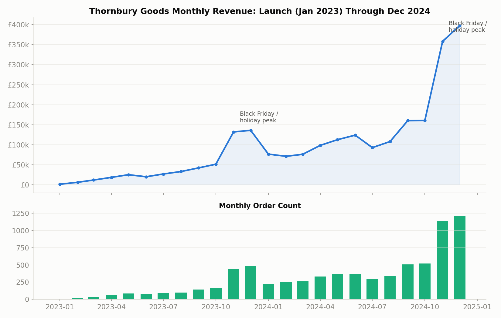
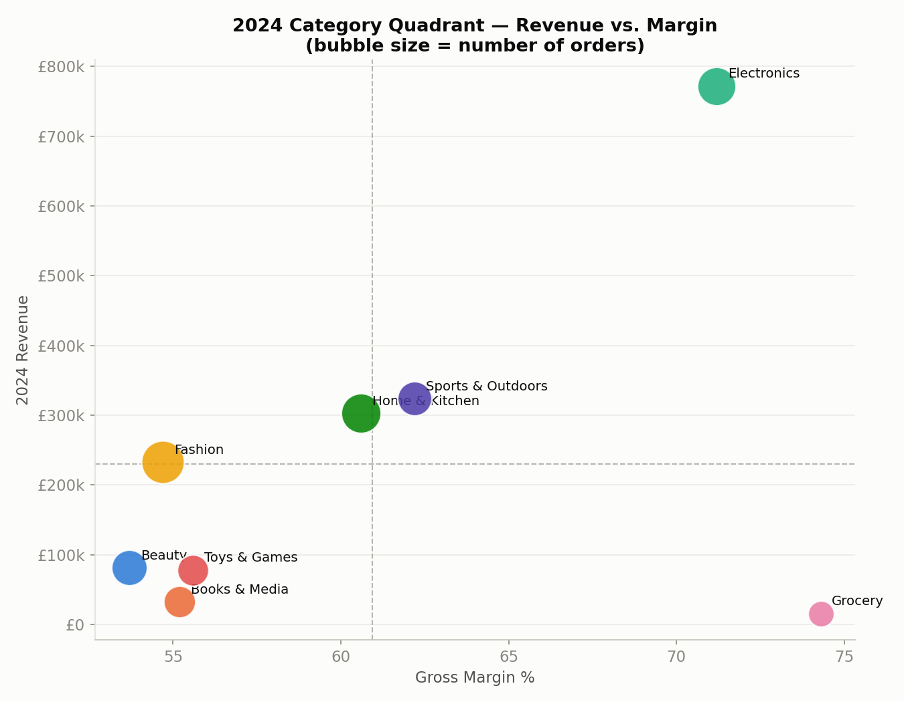
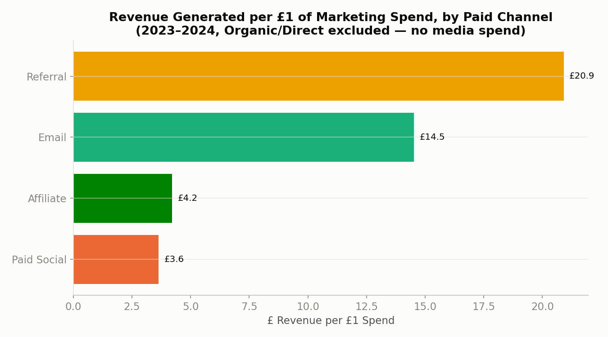
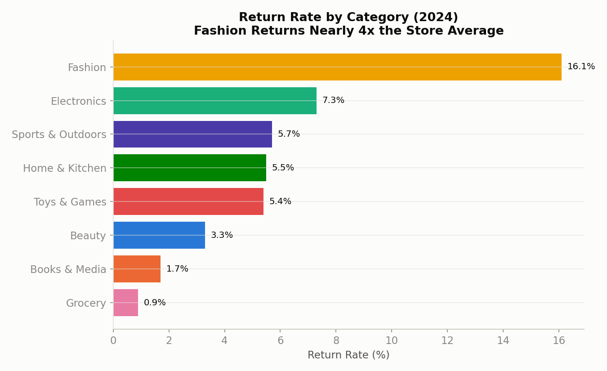
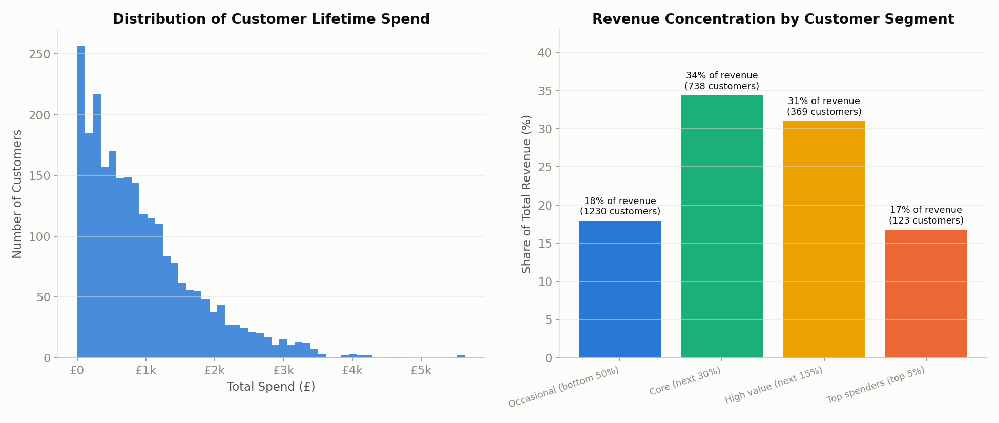
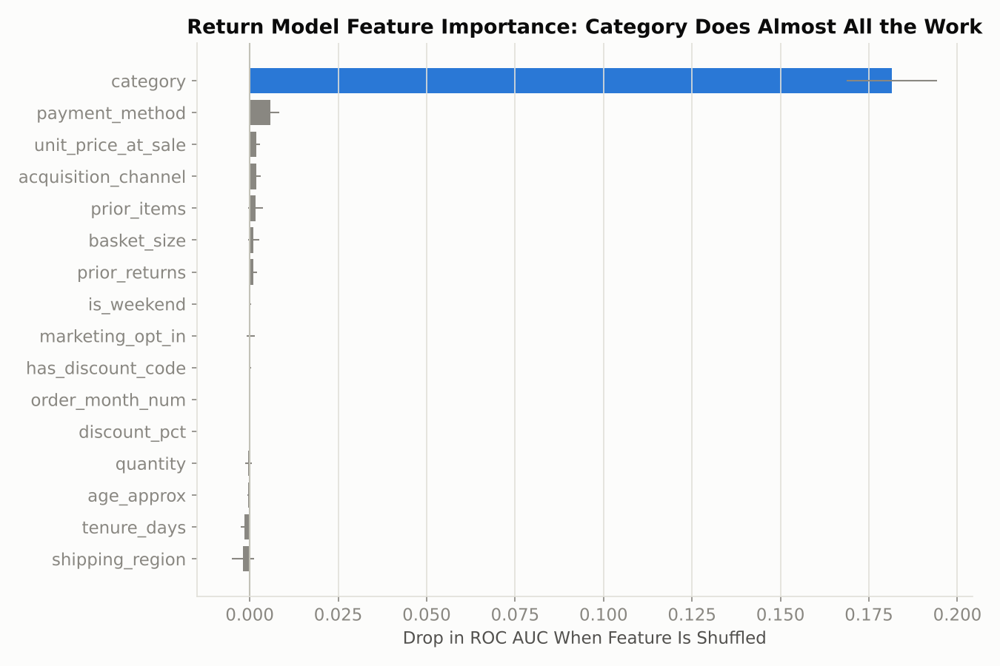
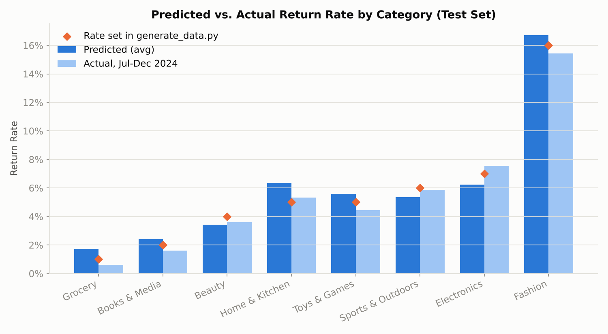

# Thornbury Goods: Retail Sales Analysis (2023-2024)

End-to-end data analytics project on a synthetic UK online retail dataset. Covers data generation, SQL cleaning, and exploratory analysis in Python.

> **Note on the data:** Thornbury Goods is a fictional retailer. The dataset is synthetically generated (see `python/generate_data.py`) with a fixed random seed, not scraped or sourced from any real company. It's built to look and behave like a real messy export, so the cleaning and analysis steps are genuine work, not just formatting a tidy CSV.

## What this project does

1. Generates a realistic, messy retail dataset: customers, products, orders, order line items, and monthly marketing spend, with seasonality, category trends, and typical data-entry problems baked in.
2. Cleans and standardises it in SQL, logging exactly what was fixed and how many rows were affected.
3. Builds a set of analysis-ready SQL views for the questions a retail team would actually ask.
4. Explores the cleaned data in Python and produces the charts below.

## Stack

Python (pandas, numpy, matplotlib, Faker) for generation and analysis. SQLite for the cleaning/transformation layer (no server setup needed, runs anywhere).

## Repository structure

```
├── README.md
├── data/
│   ├── raw/                    messy synthetic CSVs (generator output)
│   ├── cleaned/                analysis-ready CSVs (SQL pipeline output)
│   └── thornbury_goods.db      SQLite database used by the SQL pipeline
├── sql/
│   ├── 01_create_raw_tables.sql
│   ├── 02_data_cleaning.sql
│   └── 03_transformations_analysis.sql
├── python/
│   ├── generate_data.py
│   ├── load_to_sqlite.py
│   ├── eda.py
│   └── ml_return_model.py
└── charts/
    └── *.png
```

## The dataset

| Table | Rows (raw) | Description |
|---|---|---|
| customers | ~3,060 | signup date, region, acquisition channel, opt-in status |
| products | 155 | category, sub-category, cost, price, launch date |
| orders | ~7,810 | date, status, payment method, discount code |
| order_items | ~15,340 | one row per line item: product, quantity, price paid, return flag |
| marketing_spend | 96 | monthly ad spend by paid channel |

Trends built into the generator: holiday seasonality (Black Friday / Christmas spike, summer dip), a weekend order uplift, an acquisition mix that shifts from Organic Search toward Paid Social over time, category growth rates that differ (Electronics and Beauty up, Books & Media down), and return rates that vary by category (Fashion highest, Grocery lowest).

## Data quality issues (intentional)

The generator injects the kind of problems a real export has, and the SQL cleaning step fixes them, with every fix counted and logged to a `data_quality_log` table so the numbers are auditable rather than a black box.

| Issue | Table | Rows fixed | Fix |
|---|---|---|---|
| Duplicate rows | customers | 60 | Deduplicated, kept first occurrence |
| Missing/blank emails | customers | 120 | Converted to NULL |
| Inconsistent casing (`LONDON` / `london` / `London`) | customers, products | many | Mapped to one canonical value |
| Invalid (null/negative) product cost | products | 9 | Imputed with the category median cost |
| Duplicate order rows | orders | 77 | Deduplicated, kept first occurrence |
| Mixed date formats (`DD/MM/YYYY` vs ISO) | orders | 919 | Normalised to ISO 8601 |
| Negative quantities | order_items | 154 | Corrected to absolute value |
| Zero-price line items | order_items | 86 | Backfilled from the product's catalogue price |

## How the pipeline runs

1. `python/generate_data.py` builds the raw CSVs.
2. `python/load_to_sqlite.py` loads them into SQLite, runs `sql/01` and `sql/02` to clean, then `sql/03` to build the analysis views, and exports everything to `data/cleaned/`.
3. `python/eda.py` reads the cleaned CSVs and writes the charts to `charts/`.

```bash
pip install pandas numpy matplotlib Faker scikit-learn
cd python
python3 generate_data.py
python3 load_to_sqlite.py
python3 eda.py
python3 ml_return_model.py
```

Random seeds are fixed throughout, so re-running the pipeline reproduces the same data and the same charts.

## Findings

**Revenue grew from £505,612 in 2023 to £1,836,670 in 2024.** £2.34M total across both years, from 7,511 completed orders and 2,460 customers, average order value £311.85. Growth is smooth month over month with a clear spike each November-December.



**Electronics leads on both revenue and margin; Grocery has the best margin but too little volume to matter yet.** Plotting 2024 revenue against margin splits the categories into four groups: Electronics (high revenue, strong margin), Sports & Outdoors and Home & Kitchen (solid mid-tier), Fashion (high volume, thinnest margin of the major categories), Grocery (best margin, smallest revenue). Beauty is growing fastest off a small base; Books & Media is declining.



**Paid Social takes the largest share of the marketing budget but isn't the most efficient channel.** Measured as revenue per £1 of spend, Referral (£20.90) and Email (£14.52) outperform Paid Social (£3.63) and Affiliate (£4.21) by a wide margin.



**Fashion returns are nearly 4x the store average** (16.1% vs 6.9% overall), consistent with sizing/fit being the main return driver in apparel. Grocery and Books & Media return the least.



**Revenue is concentrated but not extreme.** The top 5% of customers by spend account for 17% of revenue, and the top 20% account for 48%.



A few more cuts of the data live in `charts/` but aren't embedded above, to keep this README focused: category revenue by year (`02`), weekday order pattern (`04`), acquisition channel mix over time (`05`), and cohort retention (`07`). Worth a look if you want the fuller picture, notably `07`, since retention came out flatter than expected, see Limitations below.

### Headline numbers

| Metric | Value |
|---|---|
| Total net revenue (2023-2024) | £2,342,283 |
| Completed orders | 7,511 |
| Unique customers | 2,460 |
| Average order value | £311.85 |
| YoY revenue growth | 263% |
| Store-wide return rate | 6.9% |
| Fashion return rate | 16.1% |
| Best paid channel (revenue per £1 spend) | Referral, £20.90 |
| Worst paid channel (revenue per £1 spend) | Paid Social, £3.63 |
| Revenue share from top 5% of customers | 17% |

## Return prediction model

`python/ml_return_model.py` predicts whether a line item will be returned, using only what's known at checkout: category, price, discount, payment method, basket size, customer tenure and the customer's past returns. I left `order_status` out because "Partially Returned" is only known after the return happens, so it would leak the answer.

The model trains on Jan 2023 - Jun 2024 (6,924 items) and is tested on Jul - Dec 2024 (7,969 items). Splitting by date rather than randomly is closer to how it would actually be used.

| Model | ROC AUC | Avg. precision | Returns caught in riskiest 10% |
|---|---|---|---|
| Random guess | 0.500 | 0.067 | 10% |
| Category baseline | 0.683 | 0.120 | 25% |
| Logistic regression | 0.688 | 0.127 | 26% |
| Gradient boosting | 0.682 | 0.127 | 24% |

**Flagging the riskiest 10% of items catches about a quarter of all returns**, roughly 2.5x better than random. Permutation importance shows nearly all of that comes from product category.



**Logistic regression and gradient boosting barely beat the simple category baseline, which is what I expected.** The generator sets return probability by category only, so there's no other real signal to find. Since those rates are known, I could check the predictions against them, and they line up closely. On real data, things like sizing and review scores would also affect returns, which is where the extra features should start to help.



In practice this could be used to target return-reduction work (size guides, better product photos) at high-risk items, starting with Fashion.

## Limitations

Worth being upfront about, since these directly affect how far you should trust the "findings" above:

- Customer purchase selection is independent per order, not modeled on individual loyalty. That's why the cohort retention chart looks flat and noisy rather than showing the sharper early drop-off a real retention curve usually has.
- Marketing spend is monthly and channel-level only. A real attribution analysis would use campaign-level spend and proper multi-touch attribution instead of crediting all of a customer's lifetime revenue to their original acquisition channel.
- Product demand doesn't model basket effects (e.g. Home & Kitchen buyers being more likely to also buy Grocery).

Possible extensions: a churn model on the RFM features in `vw_customer_rfm` (this needs the generator to model customer loyalty first, see above), or a revenue forecast from the monthly trend view.

---

All data, code, and analysis in this repository are original and synthetically generated for this project. Thornbury Goods is a fictional company.
